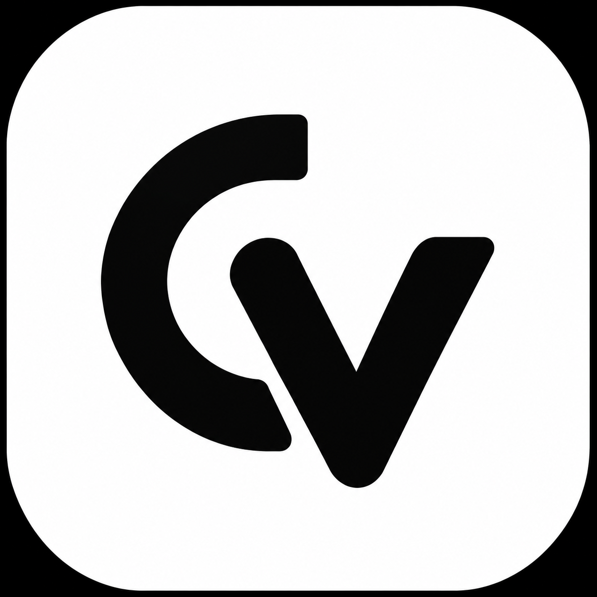

<div align="center">



# ClipCV

**Your clipboard, at the speed of thought.**

A fast, private, native clipboard history manager for macOS.

[Features](#-features) · [Install](#-install) · [Shortcuts](#-shortcuts) · [Build](#-build-from-source) · [中文](README.md)

macOS 26+ · Swift · SwiftUI · Sparkle 2

</div>

---

## Why ClipCV

Copy, switch windows, paste, switch back, paste again — re-copying wastes your time. ClipCV keeps every copy in history: hit the hotkey, type a few letters, hit return. Your hands never leave the keyboard.

- **Fast**: <kbd>⌘⇧C</kbd>, start typing, <kbd>↩</kbd> to paste. Usually under 2 seconds.
- **Private**: everything stays on your Mac. No servers, no accounts, no tracking.
- **Native**: a real macOS app that lives in your menu bar — smooth, battery-friendly, and not Electron.

## ✨ Features

### Clipboard history
- Save text, links, rich text (RTF/HTML), images (PNG/TIFF), and file paths
- Fuzzy / regex / exact search with multiple keywords (e.g. `sig file` to find a signature image)
- Filter history by source app (`from:Safari`)
- Category filters: text / images / links / files / colors / pinned
- Sort by last copied, first copied, or number of copies
- Edit the alias and content of any item
- Copy count statistics

### Pinning
- Pin frequently used snippets and recall them with a single key
- Customizable key order (default `QWEASDZXC`)
- **Pin to desktop**: keep a floating snippet on screen and drag it into any app
- Two pin layouts: top / bottom

### Image tools
- On-device OCR (Apple Vision): recognize text in images and copy it directly
- Hex color swatches (e.g. `#FF4F00`)
- Optional image downscaling on save to control storage usage
- Large image preview with dimensions and file size

### Privacy & control
- Ignore specific apps (e.g. password managers), pasteboard types, or regex rules
- "Ignore next copy"
- Pause / resume recording
- Clear history / system clipboard on quit
- Caps on item count and total size with automatic cleanup

### Appearance & localization
- English and Chinese UI, follows system language by default
- Multiple menu bar icons (ClipCV monogram by default)
- Show the latest clip in the menu bar
- Automatic light/dark mode

### Sync & updates
- Optional iCloud sync (share history across your Macs)
- Sparkle 2 auto-updates with EdDSA signature verification

## 📥 Install

### Download
Grab the latest `ClipCV.zip` from [Releases](https://github.com/wangsendi/ClipCV-MacOs/releases), unzip, and drag `ClipCV.app` into your Applications folder.

> If macOS warns about an unidentified developer on first launch, open **System Settings → Privacy & Security** and click "Open Anyway".

### Build from source
```bash
git clone https://github.com/wangsendi/ClipCV-MacOs.git
cd ClipCV
open ClipCV.xcodeproj
```
Then press <kbd>⌘R</kbd> in Xcode. Requires Xcode 27+ and macOS 26+.

On first launch, grant ClipCV access in **System Settings → Privacy & Security → Accessibility** (needed for global hotkeys and automatic paste).

## ⌨️ Shortcuts

| Action | Default |
| --- | --- |
| Open clipboard history | <kbd>⌘⇧C</kbd> |
| Pin / unpin | <kbd>⌥P</kbd> |
| Delete item | <kbd>⌥⌫</kbd> |
| Open image preview | <kbd>⌃Space</kbd> |

Inside the history list: <kbd>1</kbd>–<kbd>0</kbd> paste recent items directly; <kbd>⌘Q</kbd>–<kbd>⌘C</kbd> recall pinned items (customizable). Every shortcut can be changed in Settings.

## 🔒 Privacy

ClipCV never uploads your data (the only network access is checking for updates on GitHub):

- History lives in a local SwiftData database
- OCR runs entirely on device (Apple Vision)
- iCloud sync is optional and off by default
- Configure ignore rules for apps / types / regexes to keep sensitive content out of history

## 🛠 Build from source

```bash
git clone https://github.com/wangsendi/ClipCV-MacOs.git
cd ClipCV
xcodebuild -project ClipCV.xcodeproj -scheme ClipCV -configuration Release build
```

Dependencies resolve automatically via Swift Package Manager (only [Sparkle 2](https://github.com/sparkle-project/Sparkle)). See [ci.yml](.github/workflows/ci.yml) for CI.

## 🗂 Project structure

```
ClipCV/
├── ClipCV/
│   ├── Models/          # SwiftData models
│   ├── Services/        # Clipboard monitor, search, OCR, hotkeys, updates…
│   └── UI/              # History panel, settings, pins, menu bar
├── ClipCVTests/         # Unit tests
└── docs/                # Documentation (English & Chinese)
```

## 📄 License

Released under the [MIT License](LICENSE).

## 🙏 Acknowledgements

- [Maccy](https://github.com/p0deje/Maccy) — UX inspiration
- [Sparkle](https://github.com/sparkle-project/Sparkle) — update framework
