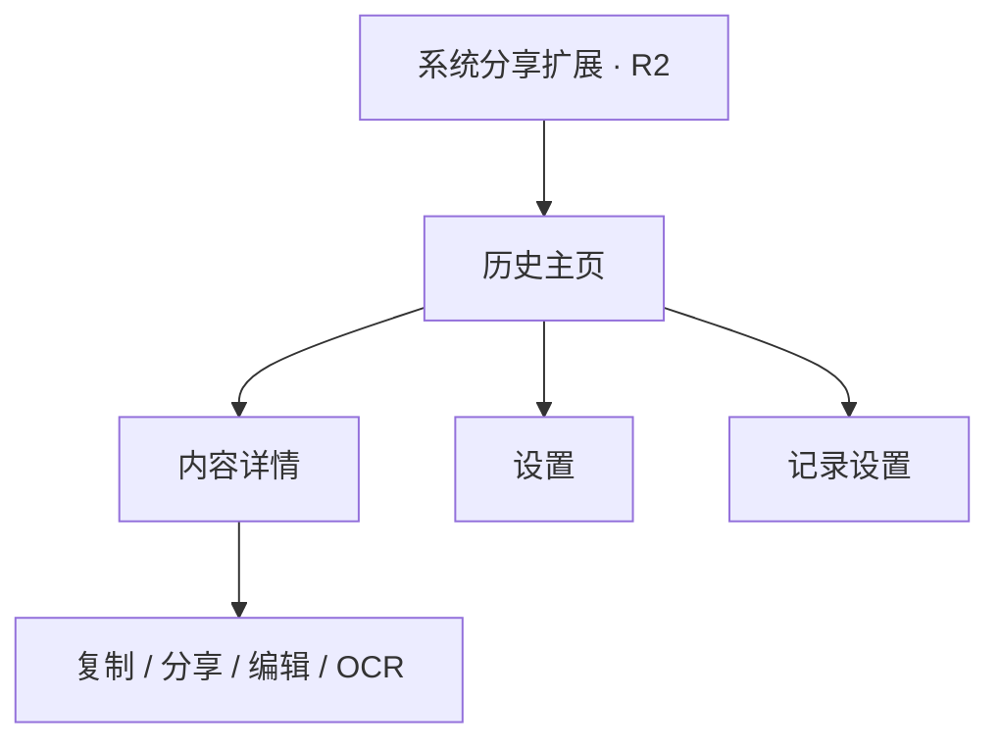

# ClipCV iOS 功能规划

功能方案及交互约定，最低版本为 iOS 27。原生初版已接入历史、前台记录、详情、设置和内容工具；实际进度见 [TODO](ios-todo.md)，代码归属见[目录说明](architecture.md)。

## 1. 产品定位

在手机上收集内容、快速取用历史，并与 Mac 共用剪贴板历史库。优先打通三个场景：

1. iPhone 复制内容后，通过前台采集或主动开启的 PiP 连续记录保存。
2. 在 iPhone 找到之前保存的内容，复制后到微信、浏览器等目标应用粘贴。
3. 在 Mac 和 iPhone 之间查找、复制、编辑和钉选同一份历史。

沿用现有原生界面、内容格式和钉选概念。每台设备使用一个主数据库；本地记录与可选 iCloud 同步使用同一份库，不增加历史库合并、旧库兼容或备份机制。

## 2. 功能全景与版本范围

R1 是首个可日常使用的版本；R2 补齐内容工具和系统分享入口；R3 为后续按需求开发的能力，不提前创建空入口。

新增输入需求：希望在其他应用打字时直接选择历史。将轻量剪贴板键盘列为 R1 候选，先验证切换输入法的实际体验，不把跨应用悬浮列表作为已可实现的交互。

| 模块 | 规划内容 | 阶段 |
| --- | --- | --- |
| 前台采集 | 首次开始记录并获允许后，在应用前台自动收录文本、链接、富文本和图片 | R1 |
| PiP 连续记录 | 目标为会话继续运行、屏幕不显示小窗，提供开始、暂停和停止 | R1 技术候选，无浮窗方式待验证 |
| 历史管理 | 列表、详情、搜索、筛选、复制、分享、编辑、删除 | R1 |
| 钉选 | 常用内容固定展示，支持排序，与 Mac 同步 | R1 |
| 原格式复制 | 按支持的格式写回剪贴板，提供单次复制纯文本 | R1 |
| 图片预览 | 原图缩放、复制、系统分享，列表使用缩略图 | R1 |
| iCloud | 文本、链接、图片、钉选、编辑和删除的跨设备同步 | R1 |
| 存储与隐私 | 数量及空间上限、类型过滤、暂停、直接清理 | R1 |
| 分享扩展 | 从 Safari、照片等应用的分享菜单收录内容 | R2 |
| OCR | 本机按需识别、复制文字，识别结果参与搜索与同步 | R2 |
| 内容预览 | JSON 格式化与高亮、Markdown 渲染、颜色预览 | R2 |
| 高级管理 | 模糊、正则、混合搜索，多种排序、批量管理与内容忽略规则 | R2 |
| iPad 优化 | 分栏详情、拖放、外接键盘快捷操作 | R2 |
| 快捷指令 | 添加文本、查询最近记录、复制钉选项 | R3 |
| 小组件 | 常用钉选项、打开历史或记录控制入口 | R3 |
| 剪贴板键盘 | 切到 ClipCV 键盘，点选历史文本直接插入当前输入框 | R1 候选，先验证交互 |
| 文件 | 显式导入真实文件、预览、分享；文件内容同步另行设计 | R3 |

来源应用筛选只使用已有的可靠来源信息。Mac 同步来的来源可展示；iOS 本机采集不承诺识别正在使用的其他应用，也不提供依赖该信息的应用黑名单。

## 3. 页面与导航

首版采用一个历史主页、一个详情页和一个设置页。钉选作为主页筛选，不增加独立收藏库或多层分类。

[可点击 UI 草图](design/ios-ui.html)采用浅灰底、白色圆润卡片、黑色主按钮和绿色强调色，参考用户提供的 [Bento UI motion grid](https://bento-ui-motion-skill.vercel.app/) 与 [Plush UI](https://plush-ui.pages.dev/)。绿色用于选中、开启及成功状态；开关使用绿色底层渐显、白色滑块弹性位移和按下时轻微拉伸。

Plush 的 shadcn 命令安装的是 React 网页组件。这里只参考其视觉、尺寸和运动节奏，正式 iOS 界面通过 SwiftUI 原生实现，不给 Xcode 工程加入 React / npm 依赖。

动效集中在筛选、钉选、开关和复制反馈，支持减少动态效果；不让列表或 PiP 为装饰持续运动。网页草图仍为模拟交互；原生实现及真机待验收项以 TODO 为准。

原型提供「页面总览」与「单页体验」，共 27 个页面与状态；总览用于比较布局，单页体验用于走通操作流程。

| 分组 | 页面 |
| --- | --- |
| 历史与查找 | 首页、钉选、搜索 |
| 开始与空状态 | 首次启动、空历史、无搜索结果 |
| 内容详情 | 文字、链接、图片 |
| 编辑与操作 | 编辑、原图预览、长按菜单 |
| 记录设置 | 设置首页、记录类型、记录状态 |
| 同步与存储 | iCloud、历史与空间、语言与外观 |
| 输入时取用 | 键盘启用指引、ClipCV 键盘、切回常用键盘，均为候选方案 |
| 内容工具 | OCR、Markdown、JSON，均为 R2 |
| 扩展与预览 | 颜色与分享扩展为 R2，文件详情为 R3 |

同步页可切换已启用、传输中、不可用和已关闭的示例状态；文件页可预览内容不可用的情况。演示中的删除和清理只作用于示例数据，刷新即可恢复。

### 历史主页

- 顶部显示 ClipCV、真实记录状态和设置入口；同步状态放在设置中，异常或待重启时才在主页显示简短入口。
- 搜索框搜索标题、别名和文本；已有 OCR 结果也参与搜索。
- 快速筛选包含「全部、钉选、文本、链接、图片」，多个条件与搜索组合生效。
- 符合当前搜索与筛选条件的钉选内容固定在顶部；长按可钉选或取消，钉选筛选中可集中查看和调整顺序。钉选状态与顺序可和 Mac 同步，自动清理及清空未钉选均保留这些记录。
- 列表展示两至三行摘要或图片缩略图，以及时间、类型、钉选状态；来源仅在有可靠数据时展示。
- 点内容进入详情，右侧复制按钮直接复制；长按提供复制纯文本、钉选、编辑、分享和删除。
- 底部提供「开始 / 停止连续记录」入口，并可暂停或恢复自动采集；首版没有手动导入、新建文本或选择照片入口。
- 没有记录与搜索无结果使用不同空状态。暂停记录或关闭同步不会隐藏已有历史。

### 内容详情

| 类型 | 内容与操作 |
| --- | --- |
| 文本 / 富文本 | 查看、选择文字、复制原格式、复制纯文本、编辑内容与别名、分享 |
| 链接 | 查看完整链接、复制、在浏览器打开、编辑；不自动访问远端获取摘要 |
| 图片 | 原图缩放、复制图片、系统分享；R2 增加识别文字与查看识别结果 |
| JSON / Markdown / 颜色 | R2 增加展示模式切换；预览不修改保存内容 |
| Mac 文件引用 | 展示文件名及不可在本机访问的状态；不伪装成可以粘贴的文件 |

富文本保持原样保存。用户明确编辑正文时才转换为普通文本，编辑页简短注明；只改别名不改变原格式。

### 设置页

按「记录、同步、存储、通用」分组，关于信息放在末尾。iPhone 使用原生表单；iPad 在 R2 适配侧栏和详情分栏，不增加另一套业务规则。

### 在其他应用中取用历史

| 方案 | 适用范围与取舍 |
| --- | --- |
| Mac 式跨应用悬浮选择窗口 | 普通 iOS 应用没有可在任意其他应用上方展示自由交互列表的通用窗口能力，不作为产品承诺 |
| PiP | 后台采集的候选载体，目标为无浮窗；不承担历史选择或向其他应用输入框插入文字 |
| 剪贴板键盘 | 用户切换到 ClipCV 键盘后点选历史，可直接插入支持第三方键盘的文本框 |
| iPad 分屏 | 历史与目标应用并排，支持时拖入文本或图片；需要单独适配 |

推荐取用流程：正常输入 → 通过地球键切到 ClipCV → 点选历史插入 → 切回常用输入法。键盘显示「最近 / 钉选」与文本摘要，保留切换键盘入口。它替换当前键盘，不会同时保留系统拼音键盘，也不能给其他输入法增加历史工具栏。

轻量键盘先只做文本插入，不开发完整拼音输入法。富文本在此按普通文本插入；图片、文件继续通过主应用复制或分享，接收方需支持对应类型。密码输入框、部分专用输入框和禁用第三方键盘的应用不可使用该入口。

主应用与 PiP 负责采集、同步，并在 App Group 中写入受大小限制的文本历史快照；键盘只读快照、按需读取文字，不打开主历史数据库、不加载原图、不运行 OCR，也不承担云端同步。插入通过系统文本代理完成，无需先改写系统剪贴板。

按苹果当前文档，未开放完全访问的键盘允许只读主应用共享容器。因此首个原型使用只读方案，不因读取历史而要求「允许完全访问」。键盘内不修改钉选、不删除记录、不回写使用次数；如果后续需要这些写操作或联网，再单独评估完全访问权限及交互。

参考：[创建自定义键盘](https://developer.apple.com/documentation/uikit/creating-a-custom-keyboard)、[键盘开放访问与共享容器权限](https://developer.apple.com/documentation/uikit/configuring-open-access-for-a-custom-keyboard)、[文本插入代理](https://developer.apple.com/documentation/uikit/uitextdocumentproxy)。

## 4. 收录与复制规则

| 场景 | 约定行为 |
| --- | --- |
| 首次启动 | 用户点开始记录并完成必要授权后，启用前台自动采集；iCloud 默认关闭 |
| 前台自动记录 | 初次启用后，未暂停且权限可用时自动检测变化，无需逐条导入；离开前台且无有效 PiP 会话时停止 |
| PiP 连续记录 | 用户主动开始，只有实际会话可用时才显示后台记录中 |
| 暂停记录 | 停止自动采集和 PiP，已有历史仍可查看、编辑、复制、钉选与同步 |
| 多张图片 | 每张图片分别保存一条记录，保持原有顺序，不把多张图合成一张 |
| 空白 / 不支持的内容 | 跳过，不新增空记录或弹窗 |
| 连续重复内容 | 沿用当前相邻去重：内容相同则更新最近记录；不全库扫描或合并已有不同记录 |
| 从历史复制 | 写入成功后更新最近使用时间及次数；未钉选项回到最近位置，钉选排序保持不变 |
| 自身写入 / 云端到达 | 自身写入不重复收录；云端收到历史不自动覆盖系统剪贴板 |

文本、URL、富文本和图片由各平台转换为受支持的表示。保存可用的原始格式，接收应用自行选择支持的格式；不宣称所有应用都能恢复第三方私有格式，也不按应用逐个添加粘贴适配。

默认复制内容原格式，提供「复制纯文本」作为单次操作。图片始终作为图片处理；有文字表示的文件也不自动降级为路径或文件名。只有写入剪贴板成功才展示成功反馈并更新使用记录。

R1 不承诺全局内容去重。Universal Clipboard 与 ClipCV 同步同时带来的独立记录，不能仅凭标题相同就删除或合并。

链接归一化只参与重复判断，不静默删除已保存链接里的参数；复制仍使用保存的原始链接。

## 5. PiP 与记录状态

PiP 作为用户主动开启的连续记录模式。参考 Yoink 的产品方式，先做当前 iOS 真机原型，再确定正式实现，不把 PiP 等同于永久后台运行。

用户指定的目标是：PiP 会话实际存续，但其他应用上方不出现小窗，也不依赖用户每次手动将小窗收起。目前查阅 iOS 27 SDK 和公开文档，没有主动隐藏窗口同时保留会话的设置；isPictureInPictureSuspended 是只读系统状态，不能作为隐藏开关。系统支持用户把小窗拖到边缘收起，但仍有恢复把手，与本次要求不同。

因此无浮窗模式属于待验证的技术目标。草图已移除可见 PiP 窗口，这仅表达目标外观，不代表底层能力已经实现；验证前不能显示假运行状态或承诺持续后台采集。

| 实际状态 | 页面反馈与行为 |
| --- | --- |
| 尚未开始 | 显示开始记录入口，无采集任务，已有同步历史仍可使用 |
| 前台记录中 | 应用前台且采集有效，持续检查变化 |
| 正在开启 PiP | 等待系统确认，不提前显示后台记录中 |
| PiP 记录中 | 仅在会话、采集任务和运行条件有效时显示，主应用提供停止入口 |
| 已暂停 | 停止自动采集与 PiP；历史操作和同步继续可用 |
| 需要粘贴权限 | 展示权限入口，停止反复读取和弹出系统授权请求 |
| 会话中断 / 不可用 | 停止后台任务并更新状态；回前台后按前台设置工作 |

具体约定：

- 前台与 PiP 共用一份采集任务，切换时不能重复读取或重复入库。
- 优先利用可用的系统变化通知，轮询作为必要补充。PiP 原型从约 1 秒检测间隔开始，用漏记、延迟和耗电实测调节。
- 没有内容变化时不读取大图片、不解码、不执行 OCR。
- 目标设计不展示 PiP 悬浮内容，记录状态只在 ClipCV 内展示；不暴露剪贴板正文或原图。
- 主应用停止后台记录或系统结束 PiP 会话后，停止后台采集；应用仍在前台时，是否继续采集由前台设置决定。
- 应用重开不会把上次「PiP 运行中」当成当前状态，也不自动弹出 PiP 窗口。
- 锁屏、电话、其他 PiP 抢占、系统回收和权限变化均需真机验证，不承诺所有场景持续运行。
- 采样之间被多次覆盖的中间内容无法回溯；停止期间的历史也无法从系统剪贴板补齐。

参考：[Yoink iOS](https://eternalstorms.at/yoink/ios/)、[Yoink 对后台监测的说明](https://blog.eternalstorms.at/2021/10/07/yoink-for-ipad-and-iphone-v2-4-improved-background-clipboard-monitoring/)、[Apple PiP 控制器](https://developer.apple.com/documentation/avkit/avpictureinpicturecontroller)、[系统暂停状态](https://developer.apple.com/documentation/avkit/avpictureinpicturecontroller/ispictureinpicturesuspended)、[用户收起画中画](https://support.apple.com/guide/iphone/multitask-with-picture-in-picture-iphcc3587b5d/ios)。这些资料不代替 ClipCV 对无浮窗模式和持续采集的实测结果。

## 6. iCloud 与共享历史库

### 同步范围

| 内容 | 同步规则 |
| --- | --- |
| 文本、链接、图片与受支持的富文本 | 同步记录及其可用内容表示 |
| 别名、钉选、钉选顺序、使用信息 | 随记录同步，两端语义保持一致 |
| OCR 结果 | 生成后同步，另一端不重复识别同一份图片 |
| 删除与内容编辑 | 作为共享库修改传播到其他启用同步的设备 |
| Mac 文件引用 | 可以保留元数据，但路径与书签不能变成 iPhone 可读文件 |
| 文件授权、缩略图缓存、采集状态、PiP 会话 | 只在本机，不随记录同步 |

继续使用现有 CloudKit 私有容器。每台设备保留自己的本地库；离线仍能收录和查看，恢复后由系统处理同步。云端接收不能触发自动复制、重复采集或弹窗。

钉选与内容状态采用持久层的合并机制，不另做版本历史或手写同步引擎。两端同时离线编辑、删除与编辑相撞、关系数据合并必须验证；没有验证的一致性行为不能提前承诺。

### 开关与生效时间

- 暂停记录只控制本机自动采集，不改变 iCloud 状态。
- 同步关闭不清空本地历史、不隐藏历史，也不停止本机记录。
- 保留现有同库方案：同步配置在完整重新打开应用后生效，不切换第二个库。
- iOS 不自行结束进程。用户更改开关后，显示简短的「重开后生效」及当前实际状态，完整关闭再打开应用后应用新配置。
- 如果用户选了关闭但尚未重开，必须明确当前仍按原配置同步，不能显示「已停止同步」。仅切到后台再回来不算完整重开。
- 关闭本机同步不会删除已经上传到 iCloud 的历史，也不会关闭其他设备的同步。
- 账户不可用或初始化只能本地运行时，状态如实显示，不能仅依据设置开关显示已开启同步。

### 同步状态

设置页至少区分「已关闭、重开后生效、iCloud 不可用、已启用」。有可靠系统事件时，再显示「正在传输、最近传输完成时间、最近错误」。

网络可用不等于上传成功；一次传输事件结束也不等于整库全部同步。没有可靠事件来源时只展示可确认的状态，不显示假进度或「全部已同步」。首版不提供无法保证效果的「立即同步」按钮。

## 7. 存储、清理与默认设置

共享库中的删除会传播到另一端，自动清理也是删除操作。因此不能把 iOS 的空间限制包装成「只清理手机缓存」。

| 设置 | 建议默认值 | 作用范围 |
| --- | --- | --- |
| 前台自动记录 | 首次开始记录并获得允许后开启 | 本机 |
| PiP | 每次主动开启，不恢复为运行中 | 本机会话 |
| iCloud | 关闭，完整重开后切换 | 本机 |
| 记录类型 | 文本、链接、富文本、图片开启 | 本机采集 |
| 原格式复制 | 开启，纯文本为单次操作 | 本机 |
| 图片保存质量 | 保留原始清晰度 | 本机新收录内容 |
| 历史上限 | 200 条、300 MB，沿用 Mac 当前值 | 同步开启时为共享库规则 |
| 自动清理 | 最旧的未钉选项优先，钉选保留 | 当前历史库 |
| 清空 | 默认清空未钉选；清空全部放在存储设置内 | 当前历史库 |
| 界面语言与外观 | 跟随系统，支持中英文 | 本机 |

共享库级别的容量规则需要在两端统一，不能让手机的默认值静默裁剪 Mac 历史。实现时用系统 iCloud 键值存储同步这少量规则，并让 Mac 一起接入；两端需要同一键值容器与对应签名权限，纳入 M0 验证。同步关闭时仅使用本地设置。未确认云端已有策略、首次接入已有历史库时，不直接按新设备默认值执行自动删除。两端现已接入同一 KVS 策略，跨设备传输与清理仍需真机验收。

数量和空间均统计钉选内容，但自动清理只删除未钉选项。若钉选内容本身已超限，保留内容并在存储页显示实际占用；不宣称上限绝对不会超过，也不为守住上限静默删除钉选。

用户主动删除和清空直接执行，不加确认弹窗。清空全部与清空未钉选使用不同、明确的操作名称；共享库清理的影响在存储页常驻说明一次。

R1 不加入按设备独立的自动过期规则；iOS 也不提供依赖退出回调的「退出时清空」。图片缩略图缓存可独立释放，不改变历史和云端数据。数据库打开失败沿用现有删除重建方式，不增加备份或迁移流程。

## 8. 图片与性能

- 列表仅加载可见项摘要和匹配屏幕尺寸的缩略图，不为每条历史保留解码原图。
- 详情放大、复制和分享使用保存的原图，避免把列表缩略图当作原图导致模糊。
- 缩略图缓存设置容量限制；页面离开、内存警告和任务取消时释放不必要资源。
- 图片解码、缩放、OCR 和内容格式化不在主线程执行；任务并发受限，可取消离屏任务。
- OCR 默认按需触发。已有结果直接复用，不在 PiP 期间批量扫描所有图片。
- 先查列表元数据，按需取内容；使用分页或限制查询，不在每次搜索、滚动时重新加载整个图片库。
- 搜索输入短暂合并处理，后台同步造成列表更新时保留滚动位置和当前选择。
- iCloud 到达一批图片时不立即同时解码、生成所有预览或打开窗口。

性能验收使用独立测试库：默认规模 200 条含 100 张图，压力规模 999 条含 500 张图；测试时单独提高空间上限，避免清理改变样本。检查连续滚动、搜索、原图缩放、前后台切换和 PiP 运行 30 分钟后的内存、发热与耗电。具体数值按最低支持的实机建立基线，不先承诺固定内存或耗电数字。

## 9. R2 内容工具与分享扩展

### 内容工具

- OCR 结果支持选择、全选复制；识别为空时在结果区域说明，不弹错误框。
- JSON 支持原文 / 格式化切换；Markdown 支持原文 / 渲染切换；复制原文与复制展示结果分开命名。
- 预览不自动执行脚本或加载外部图片，不因打开历史而访问第三方网站。
- 颜色展示只是文本的附加预览，不改变保存内容或复制格式。
- 高级搜索复用 Mac 规则；无效正则在搜索区域说明，不清空现有历史。
- 排序支持最近使用、首次复制和复制次数，默认最近使用；来源筛选只提供实际有来源数据的条目。
- 批量操作包含复制文本、钉选、分享、删除；不同内容不能一律拼成字符串伪装原格式。

### 分享扩展

- 支持文本、网页链接和图片，页面只保留摘要与保存动作；多张图片分别保存。
- 使用 App Group 暂存导入内容，主应用下次可运行时统一入库和同步，不创建第二套历史数据库。
- 暂存成功即可结束分享流程，扩展不承担长期 PiP、批量 OCR 或持续 CloudKit 同步。
- 明确区分「已接收，打开 ClipCV 后加入历史」与已正式入库；不能在暂存失败时显示成功。
- 设置合理的单次导入上限，复制完成后才能结束扩展，临时文件按成功入库结果清理。
- 来源应用、网页标题等只保存扩展实际拿到的信息，不猜测来源。

## 10. R3 文件与快捷入口

| 功能 | 后续设计边界 |
| --- | --- |
| 快捷指令 | 用户明确触发添加、查找、复制；执行条件受系统约束，不用于永久后台监测 |
| 小组件 | 显示用户选择的钉选内容或操作入口，不默认暴露全部历史；不承担后台监听 |
| 本机文件 | 经文件选择器或分享显式导入，托管真实文件以保证持久访问；不只保存临时 URL |
| 跨设备文件 | 必须传输实际文件内容并处理大小、下载和清理，不能复用 Mac 路径或授权书签冒充已同步文件 |

文件优先恢复或分享真实文件。失败时不弹文件失败提示，不悄悄粘贴文件名或目录；本机确实不可访问时，在详情中如实展示状态。现有 Mac 文件授权机制继续留在 macOS。

## 11. 设置、权限与反馈原则

- 文案只保留功能名、状态和必要说明，去掉口号与重复解释。
- 系统粘贴权限按实际用户操作申请；拒绝后保持历史可用，不循环触发授权。
- 只有用户选择保存到相册等需要权限的操作时，再申请对应权限；首版不提供从相册手动导入的入口。
- 不接入统计、广告或自建内容服务器；OCR 本机执行，iCloud 按用户实际启用状态工作。
- 采集过滤先提供类型选项；R2 增加内容正则与忽略下一次。iOS 不能可靠获知其他应用来源的部分不做假开关。
- 复制成功优先短暂按钮状态或轻触反馈，不连续弹 toast；失败不显示成功。
- 状态说明放在对应页面，避免启动公告、反复授权说明和每次操作确认。
- 采集状态、同步状态和页面加载状态独立，不用一个总开关同时控制三件事。

## 12. 与 Mac 的功能分工

| 两端共用 | macOS 保留 | iOS 单独实现 |
| --- | --- | --- |
| 历史模型、保存、相邻去重、使用排序 | 菜单栏、全局快捷键、辅助功能自动粘贴 | 前台生命周期、系统粘贴权限、PiP |
| 搜索、钉选、编辑、删除和统一清理规则 | 桌面悬浮窗、Mac 文件授权与拖拽 | 移动端列表、图片手势与分享入口 |
| OCR、内容预览中的通用处理 | Sparkle 与 GitHub DMG 发布 | 分享扩展、后续键盘与小组件 |
| CloudKit 容器及明确共享的库级设置 | Mac 面板外观与专属设置 | TestFlight / App Store 发布 |

Shared 只提取实际共用逻辑，先完成 `HistoryStore` 和纯内容规则，不提前增加通用协议、同步框架或 Swift Package。UI 和系统资源归属两个 App Target，分享扩展等到实际开发时才新增 Target。

## 13. 实施顺序与验收

| 阶段 | 工作 | 完成标准 |
| --- | --- | --- |
| M0：关键能力验证 | 当前 iOS 真机优先验证无浮窗 PiP 的技术可行性、采集与权限恢复；验证最小双端同步及只读键盘 | 明确无浮窗是否可实现，决定 PiP 与键盘的首版范围；未通过的能力不冒充已可发布 |
| M1：共享核心 | 整理 Mac 文件，提取模型、规则、HistoryStore、搜索和通用设置 | macOS 原有测试通过，复制排序、格式、文件授权和删库重建行为不回退 |
| M2：本机完整流程 | 前台自动记录、列表、详情、复制、钉选、编辑、删除、图片原图预览 | 无 iCloud 时也能独立日常使用；暂停和重开不丢历史 |
| M3：R1 集成 | 接入双端 iCloud、统一清理规则、PiP 生命周期和真实状态展示 | 两台真实设备走通收录、同步、取用、停用与中断恢复；完成图片性能验收 |
| M4：R2 | 分享扩展、OCR、内容预览、高级搜索和 iPad 交互 | 增强功能不阻塞采集、不引入重复库或主线程大任务 |
| M5：R3 按需开发 | 快捷指令、小组件与文件能力逐项设计 | 每项单独确认使用价值和平台限制后再实现 |

R1 至少验证以下用户流程：

1. 首次开始记录、拒绝 / 允许粘贴、授权后自动采集、空剪贴板与不支持的格式。
2. 前台与 PiP 切换只有一份监听；暂停、关 PiP、锁屏、中断、重新打开后状态真实。
3. 文本 / 链接 / 图片从 iPhone 到 Mac 及反向同步，离线再恢复，同步不开启时继续本地记录。
4. 钉选、复制排序、编辑、删除、容量清理在双端一致；首次接入不会按默认限制意外裁剪历史。
5. 同步开关选择值与实际运行状态不同期间说明正确；完整重开后验证新记录的传输行为。
6. iCloud 账户不可用及恢复、并发编辑和大图到达时，不出现假成功、异常重复或内容关系损坏。
7. 图片多时连续滚动和放大保持流畅、清晰，内存不会按浏览过的原图数量持续增长。
8. 分享、复制或文件访问失败不会显示成功，也不会擅自改成路径文本；删除和清空不弹确认框。

## 14. 当前建议定稿的决策

首版包含 iCloud；PiP 是否纳入取决于无浮窗模式的真机验证。核心类型为文本、链接、富文本和图片，先通过前台自动采集收录，不提供手动导入或新建入口。保留一个主页、顶部钉选区、钉选筛选和独立设置页，先做好复制与查找。

OCR、分享扩展与 JSON / Markdown 作为 R2；小组件、快捷指令和真实文件支持作为 R3。剪贴板键盘因跨应用输入需求提前为 R1 候选，先做只读文本插入原型，再确定首版范围。需要重点讨论的是键盘切换体验、PiP 真实设备表现、共享库清理规则，以及用户是否接受 iOS 同步配置完整重开后生效。
